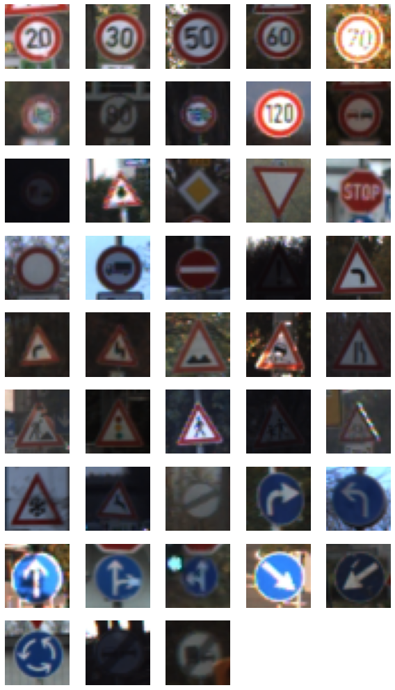
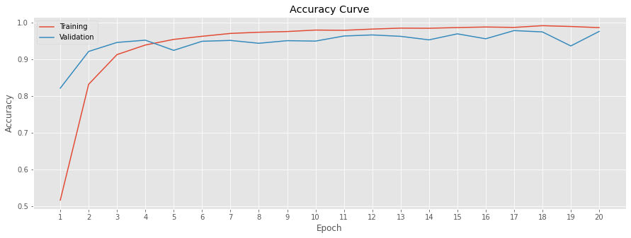

# Traffic Sign Recognition with CNNs

A convolutional neural network that classifies 43 classes of German traffic signs and reaches **98.14%** accuracy on a new, hand-collected set of Google Maps Street View images, against 72.56% for the best baseline (MLP, Random Forest, SVM).

  

Course project, MSc Data Science and Analytics, Ryerson University (2020), by Bita Houshmand and Moeen Bagheri. Full report: [traffic-sign-recognition.pdf](traffic-sign-recognition.pdf).



## Results

Accuracy of the best model of each type:

| Model | Train | Validation | Test | Google Maps images |
|---|---|---|---|---|
| **CNN** (augmentation + dropout) | 99.95% | 97.73% | 95.80% | **98.14%** |
| MLP | 96.78% | 88.41% | 85.78% | 72.56% |
| Random Forest (HOG features) | 100% | 93% | 90% | 71% |
| SVM (HOG features, RBF kernel) | 100% | 90% | 91% | 70% |

The Google Maps set is the real test of generalization: images from a different source, size, and camera than the training data. The baselines fit the training set almost perfectly and lost 20 to 30 points there. The CNN did not.

Ablations on the CNN:

- **Image augmentation** (rotation, zoom, shear) was the biggest factor. Without it, Google Maps accuracy fell from 98.14% to 86.98% even though training accuracy reached almost 100%.
- **Dropout rate** was sensitive: removing dropout cut Google Maps accuracy to 95.81%, and raising the dense-layer rate to 0.5 cut it to about 70%.
- Error heatmaps show which sign pairs the CNN confuses, mainly similar speed limits (50 vs 30 km/h, 70 vs 30, 80 vs 50) and general caution vs double curve.



## Approach

- **Data.** The preprocessed [GTSRB](https://www.kaggle.com/datasets/valentynsichkar/traffic-signs-preprocessed) split: 34,799 training, 4,410 validation, and 12,630 test images, RGB at 32×32. For a final test, about 5 images per class were collected from Google Maps Street View (a few from image search for rare signs), cropped square, and labeled.
- **CNN.** Four convolutional layers (5×5 then 3×3 kernels) with dropout 0.1 after each, then dense layers of 512 and 1,028 units with dropout 0.2 and a 43-way softmax. Trained for 20 epochs on an augmentation generator; the checkpoint with the lowest validation loss was kept.
- **Baselines.** An MLP on flattened pixels; Random Forest on PCA components and on HOG descriptors with several settings; a one-vs-one SVM (903 binary classifiers) on HOG descriptors tuned by grid search.

## Repository layout

```
traffic-sign-recognition.ipynb   preprocessing, CNN, MLP, evaluation plots
traffic-sign-recognition.pdf     full report with literature review, RF and SVM baselines
tests.zip                        Google Maps test images plus targets.csv labels
images/                          figures used in this README
```

## Running it

1. Download `train.pickle`, `valid.pickle`, `test.pickle`, and `label_names.csv` from the [Kaggle dataset](https://www.kaggle.com/datasets/valentynsichkar/traffic-signs-preprocessed).
2. Unzip `tests.zip` and move `tests/targets.csv` up one level.
3. Arrange a project folder as `data/*.pickle`, `label_names.csv`, `targets.csv`, `tests/`, `models/`, and set `proj_dir` in the notebook to it. The notebook mounts Google Drive by default, so it runs as is in Colab; skip the mount cell to run locally.
4. Install `tensorflow`, `scikit-learn`, `scikit-image`, `pandas`, `matplotlib`, `seaborn`, and `pillow`, then run the notebook.

## Tech stack

Python, TensorFlow/Keras, scikit-learn, scikit-image (HOG), pandas, NumPy, Matplotlib, seaborn, Google Colab.

## Authors

Bita Houshmand and [Moeen Bagheri](https://moeenbagheri.com)
